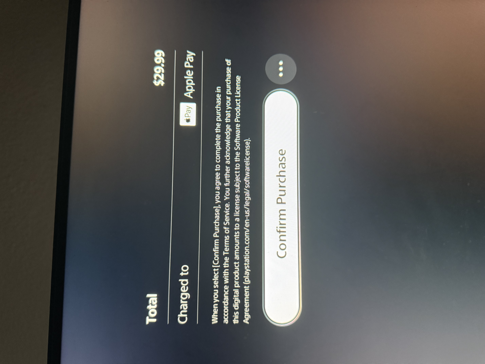
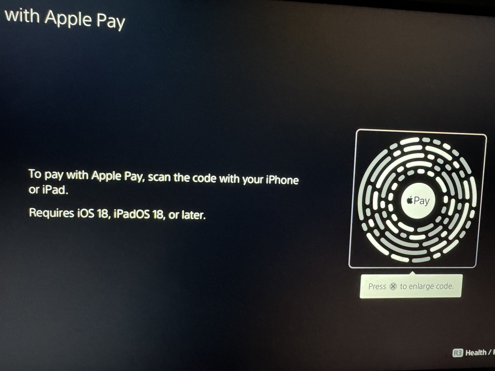

# Apple Pay Failure on the PlayStation Store

The other day I was trying to purchase a game on my PlayStation 5 using the Playstation Store. On the checkout screen i noticed there was an ApplePay option instead
of having to enter my card details manually. I thought this would be convenient since typing with a controller can be slow, so I decided to use the option. After selecting ApplePay,
the store displayed an image to scan with my phone. 

I scanned it, and my phone showed the checkout details with all the correct information. I confirmed the purchase, my phone did the face scan, everything seemed to be going fine.
It was loading the payment, then I received a "process failed" message and was returned to the payment options. This confused me as I use Apple Pay regularly, more often than 
actually using my card. I decided to attempt the purchase using Apple Pay again but received the same error. I tried once more and got the same result, I was frustrated. 
At this point I figured I might as well just enter my card information manually using my controller. Three minutes later, the purchase went through just fine, 
and I was able to finally complete my transaction. 

A UX concept I think the PS Store failed at here was **feedback**. The store did give me a message saying the process failed, but it did not tell me why. The only message was 
"process failed". I was aware of that but it left me confused on whether the issue was with my card, something on their end, or a connection issue. 
If I had received a better error message, I could have avoided trying multiple times and saved myself some time. On a related note, I believe they also failed in **efficiency**. 
Apple Pay was meant to save time, instead I spent more time than if I entered my information manually at the beginning. 

A solution for the PS Store is to give a more detailed explanation as to what caused the failure. While some users may prefer the short error message, I believe they should add a 
"details" option so users can see why a purchase had failed. For example, if it was my card information being bad I would know to try a new card. If it was a connection issue I 
would know I just need to try again later. Something as simple as this could make the shopping experience better for their customers. 
